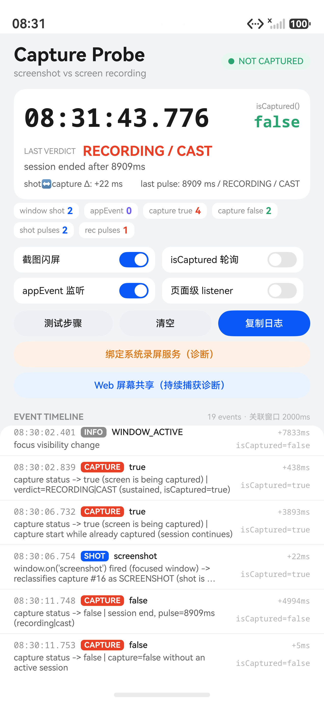

# CaptureProbe — 截屏 vs 录屏监听验证 PoC

一个单页 HarmonyOS 应用，用来实测两件事：

1. `display.on('captureStatusChange')` 能否捕捉到截屏（拍一张静态图）以及录屏/投屏；
2. `window.on('screenshot')` 的回调时机 —— 它相对 `captureStatusChange` 的先后、相对真实画面帧的先后。

同时顺带对比 `window.on('screenshotAppEvent')`（API 20+）与 `display.isCaptured()` 的实际表现。

> 实测环境：HarmonyOS 6.1.1 / API 24 模拟器（Pura 90）+ **HUAWEI Pocket 2 真机（OpenHarmony 7.0.0.105 / API 26）**。两套环境均已跑通，真机复核数据见 [docs/report.md](docs/report.md) 第 10 节。

## 结论速览

- **能捕捉截屏**：每次截屏都会触发 `captureStatusChange(true)`。注意真机退后台约 1s 后进程会被系统冻结，之后的截屏事件会丢失（见下方「后台」一条）。
- **录屏/投屏是持续捕获**：开始 `captureStatusChange(true)` 时 `isCaptured()=true`，期间没有 capture 事件、也没有 `window.on('screenshot')`，停止时 `captureStatusChange(false)`、`isCaptured()=false`，脉冲时长等于录制时长。录屏中再截屏会额外收到一次 `true`（`isCaptured` 仍为 true）和一次 `screenshot`，会话继续；停止时**可能**收到两个 `false`（真机系统录屏只发一个，模拟器 WebRTC 共享发两个）。
- **单看 boolean 分不清，但回调里的 `isCaptured()` 可以**：截屏时 `isCaptured=false`（瞬时捕获），持续捕获时 `isCaptured=true`。PoC 已改为以此为主判据，模拟器和真机均验证通过。
- **`window.on('screenshot')` 晚于 `captureStatusChange(true)`**：模拟器晚 1–58ms，真机晚 1–3ms。这与官方 FAQ「截屏事件总是发生在录屏事件之前」的顺序假设相反，按 FAQ 的 flag 写法会把截屏误判成录屏。
- **回调晚于画面捕获**：触发截屏的那张图里没有 App 的闪屏反应，0.6–1.5s 后再截一张才会带上闪屏。也就是说 `window.on('screenshot')` 是事后通知，不能用来遮挡当前这张截图（真机同样复现）。
- **后台窗口收不到 `window.on('screenshot')`，且真机会冻结进程**：退到后台后截屏没有 `screenshot` 回调，只有 `captureStatusChange(true)`；并且真机退后台约 1s 后进程进入 `freezer:/Frozen`，连 `captureStatusChange` 也不会送达（恢复前台不补发）。因此后台截屏检测只在「前台 / 刚退后台约 1s」内可靠。
- **`screenshotAppEvent` 只覆盖系统截屏流程**：控制中心截屏模拟器约 1.9s、真机 289–443ms 后才收到 `SYSTEM_SCREENSHOT`；`uitest screenCap` 不触发。不可用于实时检测。
- **`isCaptured()` 对截屏无效**：包括在 `captureStatusChange(true)` 回调内，始终为 `false`；100ms 采样也从未捕捉到翻转。



## 目录结构

```
capture-probe/
├── entry/src/main/ets/
│   ├── common/ProbeStore.ets      # 单例事件时间线 + ±2s 双向关联/重分类 + 统计
│   ├── common/CaptureMonitor.ets  # 所有系统监听器的注册/注销 + isCaptured 采样器
│   ├── entryability/EntryAbility.ets  # 在 Ability 主窗口上注册 window.on('screenshot')
│   ├── pages/Index.ets            # 探针 UI：状态、判定、原始时间线、闪屏遮挡实验
│   ├── pages/ShareProbe.ets       # WebRTC 屏幕共享诊断页（持续捕获）
│   └── resources/rawfile/share.html  # getDisplayMedia 测试页
├── docs/report.md                 # 实验报告（数据、原始日志、结论、真机验证步骤）
└── docs/screenshots/              # 实测截图
```

## 构建与运行

```bash
cd capture-probe
devecocli build             # 或 devecocli build --product default
devecocli run --device <serial>
```

本工程使用 API 24 编译（`compileSdkVersion` 跟随 SDK 6.1.1）。`screenshotAppEvent` 需要 API 20+。

真机安装需要签名：先 `devecocli auth login`（华为开发者账号），再 `devecocli signature generate`，它会把本机调试证书/Profile 写进 `build-profile.json5`（含绝对路径，属于本机配置，不建议提交）。模拟器可跳过这一步。

## App 怎么用

- **顶部状态卡**：实时时钟（毫秒）、`isCaptured()`、最近一次判定（SCREENSHOT / RECORDING·CAST）、`shot↔capture Δ`、脉冲时长。
- **计数条**：`window shot`、`appEvent`、`capture true/false`、按判定拆分的脉冲数。
- **开关**：
  - `截图闪屏`：收到 `window.on('screenshot')` 时全屏红色闪屏 2s（用于验证回调与画面帧的先后）。
  - `isCaptured 轮询`：每 100ms 采样一次，只在翻转时记一条 SAMPLE。
  - `appEvent 监听`：注册/注销 `screenshotAppEvent`。
  - `页面级 listener`：在页面窗口上再注册一个 `screenshot`，验证多监听器是否都回调。
- **按钮**：测试步骤、清空、复制日志（写系统剪贴板）；下面两个是诊断入口：
  - `绑定系统录屏服务（诊断）`：尝试 `connectServiceExtensionAbility` 系统录屏服务，模拟器上会被拒绝；
  - `Web 屏幕共享（持续捕获诊断）`：打开 H5 `getDisplayMedia()` 页面，授权后产生一段持续捕获会话，用来实测录屏/投屏的事件流（见报告第 6 节）。
- **事件时间线**：`时间 | 类型 | 事件 | Δ(距上一条) | isCaptured 采样 | 备注`。时间来自各回调入口的 `Date.now()`。

日志同时通过 `hilog` 输出，tag 为 `CaptureProbe`：

```bash
hdc shell "hilog -T CaptureProbe -x"
```

## 判定算法（`ProbeStore.analyze`）

`captureStatusChange` 与 `screenshot` 谁先到并不固定，因此不做顺序假设：

- 收到 `CAPTURE(true)` 时先看回调内 `isCaptured()`：
  - `true` → 持续捕获（录屏/投屏/屏幕共享），记录会话起点，判定 `RECORDING / CAST`；
  - `false` → 瞬态捕获（截屏），向前后 2s 找 `SHOT` 关联确认，判定 `SCREENSHOT`。
- 会话进行中又收到 `CAPTURE(true)`：视为「录屏中截屏」，不重置会话起点；随后的 `SHOT` 会把这条 capture 标成 `SCREENSHOT`，会话继续。
- 收到 `CAPTURE(false)`：会话结束，`pulse = now - sessionStart`；会话结束后紧跟着的重复 `false` 会被忽略。
- 如果 `SHOT` 比 `CAPTURE(true)` 晚到（本次实测的常见情况），会回溯把刚收到的那条 capture 事件重新标记为截图，并写一条说明。
- 2s 内没有配对的 `SHOT` 且 `isCaptured=false`，标记为 `SCREENSHOT (likely)` —— 这是后台截屏的典型形态。

`SHOT` 事件只在窗口聚焦时才会出现，所以后台截屏会落入「无 screenshot 事件的 capture=true」这个分支，UI 会显式提示这一点。

## 已知限制

- 模拟器无法启动系统「屏幕录制」（控制中心开关无响应，直接拉起 `com.huawei.hmos.screenrecorder` 的 ability 报权限错误）。为了拿到持续捕获的事件流，PoC 增加了「Web 屏幕共享」诊断页：H5 调 `getDisplayMedia()`，由应用授权，走的是系统同一套屏幕捕获服务（系统弹窗文案就是 "record or cast everything on your screen"）。真机上已用系统「录屏」磁贴直接验证到 `true/isCaptured=true → false`（脉冲 17.6s，见报告第 10.3 节）。
- **后台检测受系统冻结限制**：真机退后台约 1s 后进程进入 `freezer:/Frozen`，之后既没有 `window.on('screenshot')`，也没有 `captureStatusChange`，恢复前台也不补发。普通应用无法在后台持续监听截屏。
- `setWindowPrivacyMode` 需要 `ohos.permission.PRIVACY_WINDOW`（系统/ACL 权限），普通应用不可用，因此没有做进 PoC。
- 事件顺序与时延随设备、系统版本、触发路径（手势/控制中心/`uitest screenCap`）变化，报告中的数值只代表实测的两台设备。
- 工程当前已在本机 `build-profile.json5` 写入调试签名（由 `devecocli signature generate` 生成），因此可以直接 `devecocli run --device <serial>`。该配置含绝对路径与账号信息，**不随仓库提交**；新克隆的仓库需要重新生成。
