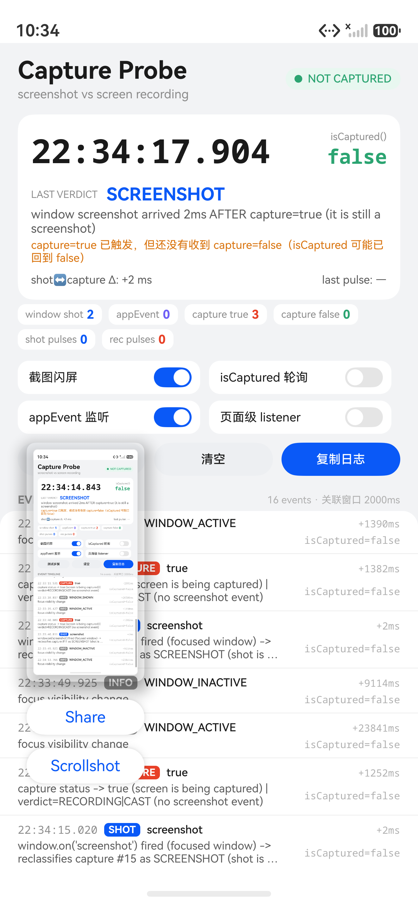
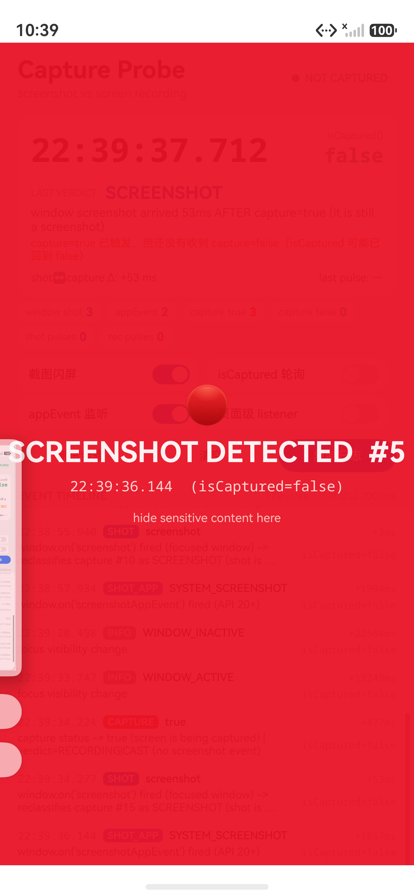
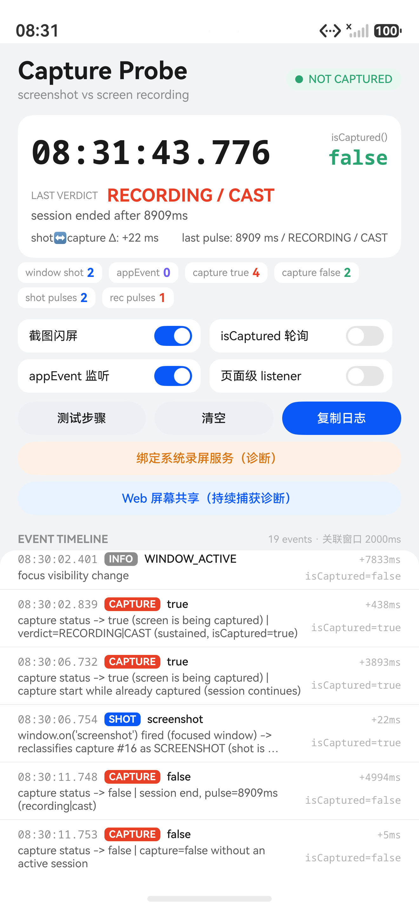
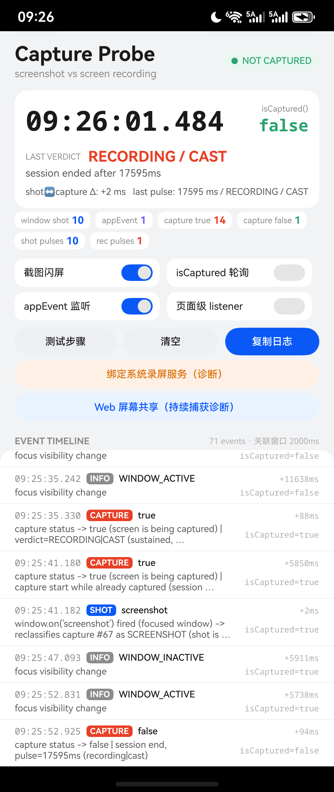
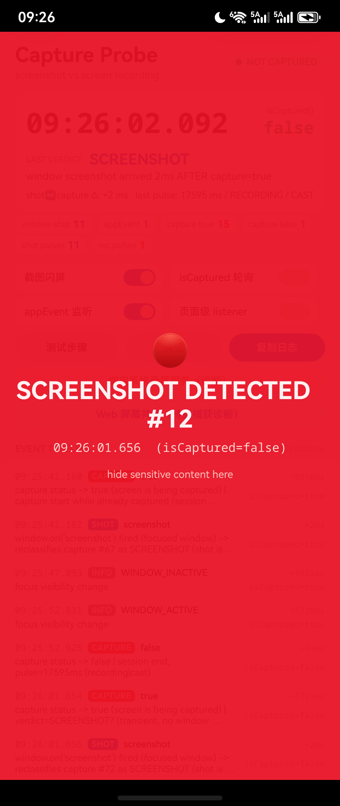

# CaptureProbe 实验报告：截屏 / 录屏监听与 `window.on('screenshot')` 回调时机

- 日期：2026-11-04 ～ 2026-11-05
- 设备：
  - 模拟器：HarmonyOS `Pura 90`，HarmonyOS 6.1.1（API 24）——第 1～7、9 节的数据
  - 真机：HUAWEI Pocket 2（LEM-AL00），OpenHarmony 7.0.0.105 / API 26 ——第 10 节的复核数据
- 工程：`capture-probe`，bundle `com.example.captureprobe`
- 观测手段：应用内单条事件时间线（`Date.now()` 毫秒级，回调入口打点）+ `hilog -T CaptureProbe`
- 复现入口：`docs/screenshots/`、本文第 8 节

## 0. 结论摘要

| 问题 | 结论 |
| --- | --- |
| `display.on('captureStatusChange')` 能捕捉截屏吗？ | 能。每次截屏都收到 `captureStatusChange(true)`；但**真机退后台约 1s 后进程被冻结，事件会丢**（第 10.5 节）。 |
| 能只靠它区分截屏和录屏吗？ | 不能。只有一个 boolean，且截屏只观察到 `true`，没有配对的 `false`；`isCaptured()` 全程为 `false`。 |
| 和录屏怎么区分？ | 回调内 `isCaptured()`：截屏为 `false`（瞬时捕获），录屏/投屏为 `true`（持续捕获）。窗口聚焦时再用 `window.on('screenshot')` 做 ±2s 关联确认。真机已复核。 |
| `window.on('screenshot')` 和 `captureStatusChange` 谁先？ | 模拟器 `captureStatusChange(true)` 先、`screenshot` 晚 1–58ms；真机 1–3ms，方向一致。与官方 FAQ 的顺序假设相反。 |
| `window.on('screenshot')` 相对真实画面帧的时机？ | 回调发生在画面已被捕获之后。触发截屏的那张图里没有 App 的闪屏反应；0.6–1.5s 后再截一张才带上闪屏。**真机复现**（第 10.4 节）。不能用于遮挡当前截图。 |
| `screenshotAppEvent` 好用吗？ | 只覆盖系统截屏流程：模拟器延迟约 1.9s，真机 289–443ms；`uitest screenCap` / `snapshot_display` 不触发。适合「截屏已保存」类统计，不适合实时检测。 |
| 录屏的事件流是什么？ | `captureStatusChange(true)`（`isCaptured=true`）→ 期间无事件 → `captureStatusChange(false)`（`isCaptured=false`），脉冲=录制时长；录屏中截屏会多一次 `true` + `screenshot`，停止时可能重复 `false`。见第 6 节与第 10.3 节。 |
| 录屏/投屏验证了吗？ | 已验证。模拟器用 WebRTC 屏幕共享拿到事件流；**真机用系统「录屏」磁贴复现**：启动 `true`+`isCaptured=true`、停止 `false`、脉冲 17.6s（第 10.3 节）。 |

## 1. 实验环境与方法

### 1.1 触发截屏的几种方式

| 编号 | 方式 | 说明 |
| --- | --- | --- |
| T1 | `hdc shell uitest screenCap -p /data/local/tmp/x.jpeg` | 系统截图 API，接近「应用内截屏」 |
| T2 | `hdc shell snapshot_display -f /data/local/tmp/x.jpeg` | 截屏服务直接抓屏 |
| T3 | 下拉控制中心 → `Screenshot` 磁贴 | 系统截屏 UI，最接近用户手势截屏 |
| T4 | `uitest uiInput keyEvent 16 18`（音量下 + 电源） | 模拟器上先触发息屏，未产生有效截图，但留下一条 `capture=true` |
| T5 | 回桌面（Home）后截屏 | 验证非前台窗口的行为 |
| T6 | 控制中心 → `Screen recorder` | 未能启动（见第 6 节） |
| T7 | PoC 内 H5 `getDisplayMedia()` + 系统授权 | 持续捕获会话，用来模拟录屏/投屏的事件流（见第 6 节） |

### 1.2 观测点

- `display.on('captureStatusChange', cb)`：记录 boolean、回调时刻，并在回调内立即读一次 `display.isCaptured()`。
- `window.on('screenshot', cb)`：注册在 `EntryAbility.onWindowStageCreate` 的主窗口上（官方推荐位置），回调内同样读 `isCaptured()`。
- `window.on('screenshotAppEvent', cb)`（API 20+）：记录 `ScreenshotEventType`。
- 可选：页面窗口再注册一个 `screenshot` 监听，验证多监听器。
- 可选：100ms 轮询 `display.isCaptured()`，只在翻转时记录。
- 可选：收到 `screenshot` 时全屏红色闪屏 2s（`截图闪屏` 开关），用于判断回调与画面帧的先后。

### 1.3 时间线的读法

每条事件包含：时钟（毫秒）、类型、事件、`Δ`（距上一条事件的毫秒数）、回调内 `isCaptured` 采样、备注。`Δ` 只在同一进程内比较，跨进程（如系统截图 UI）不参与。

## 2. `captureStatusChange` 能捕捉截屏吗？

能。10 次有效截屏（T1/T2/T3）全部收到 `captureStatusChange(true)`，时间点均在截图动作发生时。

| # | 触发 | `capture=true` | `window.screenshot` | Δ | `screenshotAppEvent` |
| --- | --- | --- | --- | --- | --- |
| 1 | T1 | 22:23:58.101 | 22:23:58.104 | +3ms | 无 |
| 2 | T2 | 22:24:09.208 | 22:24:09.210 | +2ms | 无 |
| 3 | T1 | 22:32:08.436 | 22:32:08.494 | +58ms | 无 |
| 4 | T1 | 22:34:52.873 | 22:34:52.912 | +39ms | 无 |
| 5 | T1 | 22:35:20.915 | 22:35:20.918 | +3ms | 无 |
| 6 | T1 | 22:36:50.838 | 22:36:50.840 | +2ms | 无 |
| 7 | T3 | 22:38:55.937 | 22:38:55.940 | +3ms | 22:38:57.934（+1994ms） |
| 8 | T3 | 22:39:34.224 | 22:39:34.277 | +53ms | 22:39:36.144（+1867ms） |
| 9 | T1 | 22:39:38.027 | 22:39:38.028 | +1ms | 无 |
| 10 | T1 | 22:39:52.382 | 22:39:52.384 | +2ms | 无 |

但有两个重要细节：

1. **没有 `captureStatusChange(false)`**：10 次截屏，`capture false` 计数始终为 0；等待 10s 也没有补发。
2. **`isCaptured()` 始终为 `false`**：包括在 `captureStatusChange(true)` 回调内部立即调用。100ms 采样器也从未捕获到翻转。

原始日志（节选）：

```
22:38:55.937 | CAPTURE | display | true | isCaptured=false | delta=478ms | capture status -> true
22:38:55.940 | SHOT    | window  | screenshot | isCaptured=false | delta=3ms | window.on('screenshot') fired
22:38:57.934 | SHOT_APP| window  | SYSTEM_SCREENSHOT | isCaptured=false | delta=1994ms | screenshotAppEvent
22:39:34.224 | CAPTURE | display | true | isCaptured=false | delta=477ms | capture status -> true
22:39:34.277 | SHOT    | window  | screenshot | isCaptured=false | delta=53ms | window.on('screenshot') fired
22:39:36.144 | SHOT_APP| window  | SYSTEM_SCREENSHOT | isCaptured=false | delta=1867ms | screenshotAppEvent
```

**解释**：截屏是一次瞬时捕获，系统可能只广播「开始捕获」，不广播「结束」；`isCaptured()` 表示的是持续捕获（录屏/投屏）状态，不覆盖瞬时截屏。因此：

- 不要把 `captureStatusChange` 当成可配对的 start/end 状态机；
- 不要把 `isCaptured()` 当作截屏检测手段；
- 收到 `true` 后如果 2s 内没有 `false`，应当把它当成「一次性事件」而不是「正在录屏」。

## 3. 截屏 vs 录屏：能否区分？

### 3.1 官方 FAQ 的顺序假设在本机不成立

官方 FAQ《如何监听屏幕截屏、录屏及投屏状态变化》给出的方案是：

1. 在 `EntryAbility` 的 `window.on('screenshot')` 里把 `AppStorage` 的状态置 1；
2. 在 `display.on('captureStatusChange')` 回调里读这个状态：0 → 认为是录屏/投屏，1 → 认为是截屏。

这个方案隐含一个前提：**截屏的 `window.on('screenshot')` 一定先于（或至少不晚于）`captureStatusChange`**。本机实测恰好相反：

- 10 次截屏（第 2 节表格）全部是 `capture=true` 先到，`screenshot` 晚 1–58ms；
- 按 FAQ 写法，`captureStatusChange` 回调读到的状态是 0，会把截屏判成「投屏/录屏」；
- 等 `window.on('screenshot')` 到达时，提示已经发出去了。

PoC 第一次运行时完整复现了这个误判：

```
22:23:58.101 CAPTURE true  ... verdict=RECORDING|CAST (no screenshot event)
22:23:58.104 SHOT screenshot ... reclassifies capture #6 as SCREENSHOT (shot is +3ms late)
```

也就是说，**顺序不能作为分类依据**。

### 3.2 PoC 的做法：`isCaptured()` 分会话 + ±2s 窗口确认截屏

`ProbeStore.analyze()` 不再把「顺序」当判据，而是先用 `isCaptured()` 分开两种捕获：

- `CAPTURE(true)` 且回调内 `isCaptured() === true`：持续捕获会话开始（录屏/投屏/屏幕共享），记录会话起点，判定 `RECORDING / CAST`；
- `CAPTURE(true)` 且 `isCaptured() === false`：瞬态捕获（截屏），向前后 2s 找 `SHOT` 关联确认；
- 会话进行中又收到 `CAPTURE(true)`（且 `isCaptured=true`）：视为「录屏中截屏」，不重置会话起点；随后的 `SHOT` 把这条件 capture 标成 `SCREENSHOT`，会话继续；
- `CAPTURE(false)`：会话结束，`pulse = now - sessionStart`；会话结束后紧跟着的重复 `false` 忽略；
- `SHOT` 比 `CAPTURE(true)` 晚到时，回溯把最近一条未归类的 capture 事件标成 `SCREENSHOT`（本机常见 +1–58ms）。

这条路径在本机 10/10 次截屏上给出 `SCREENSHOT`，两次持续捕获会话都给出正确的 `RECORDING / CAST` 与录制时长，且日志保留原始顺序，方便复核。

### 3.3 剩余的二义与边界

**后台截屏**（T5）：App 按 Home 退到后台后截屏，只收到 `capture=true`，没有 `window.on('screenshot')`。但回调内 `isCaptured=false`，可以判定为瞬态截屏（PoC 标记为 `SCREENSHOT (likely)`）：

```
08:29:21.761 | INFO  | window | WINDOW_HIDDEN
08:29:24.670 | CAPTURE | display | true | isCaptured=false | verdict=SCREENSHOT? (transient, no window screenshot event)
（随后没有 SHOT，也没有 false）
```

> 这是模拟器的行为。真机上退后台约 1s 后进程会被系统冻结（`freezer:/Frozen`），之后的截屏事件**根本不会送达**，恢复前台也不补发 —— 见第 10.5 节。也就是说后台截屏检测只在「刚退后台的 ~1s」窗口内有效。

如果某个设备/版本上 `isCaptured()` 在持续捕获的起始回调里还没变成 `true`，这里仍会退化成二义。

**息屏/锁屏**（T4）：注入电源键后窗口隐藏，3s 后仍收到一条 `capture=true`（`isCaptured=false`，推测是黑屏画面被捕获），同样没有 `screenshot` 回调。按新判据它会被标成 `SCREENSHOT (likely)`，而旧日志里还是 `RECORDING|CAST`。

**其他应用触发的录屏/投屏**：`display` 是设备级 API，别的应用录屏同样会让本应用收到 `isCaptured=true` 的 `true`；这会被正确判成 `RECORDING / CAST`，但无法归因到具体应用（API 不提供来源）。

**系统录屏 App 本身未在模拟器复现**：见第 6 节；目前用 WebRTC 屏幕共享验证了持续捕获的事件流。

## 4. `window.on('screenshot')` 的回调时机

### 4.1 相对 `captureStatusChange`

本机 10 次截屏的延迟分布：1、1、2、2、2、3、3、39、53、58 ms。中位数约 3ms。系统截图 UI（T3）路径为 3ms 和 53ms，`uitest screenCap` 为 1–58ms，没有出现「screenshot 先到」的样本。真机 12 次为 1–3ms（第 10.1 节），方向一致。

这说明 `window.on('screenshot')` 是系统捕获完成后才派发的通知，而不是捕获前的钩子。

### 4.2 相对真实画面帧：回调晚于画面

这是本次 PoC 最关键的一个实验。做法：

1. 打开「截图闪屏」，收到 `window.on('screenshot')` 时立刻全屏红色闪屏 2s；
2. 用控制中心 `Screenshot` 截屏；
3. 观察系统截图缩略图（即刚保存的那张图）里有没有红色闪屏。

结果（`docs/screenshots/screenshot-preview.png`）：

- 截图缩略图里**没有**红色闪屏；
- App 界面时钟停在 `22:34:14.843`，而 `capture=true` 是 `22:34:15.018`、`SHOT` 是 `22:34:15.020`；
- 1.5s 后再截一张（`docs/screenshots/flash-overlay.png`），画面里就能看到 `SCREENSHOT DETECTED #5` 的红色闪屏。

结论：**触发截屏的那一帧在回调之前就已经合成完毕**。在 `window.on('screenshot')` 里改 UI、切隐私页都来不及遮挡当前这张图；它只能用于「事后提醒」或「下一次」防护。

截图缩略图（系统刚保存的那张图，画面里没有闪屏）：



1.5s 后的另一张截屏（已带上闪屏，说明闪屏确实在渲染）：



> 注意：以上是模拟器 + 控制中心路径的结果。真机截图管线可能不同，建议用同一 PoC 在真机上复测（尤其关注「缩略图里有没有闪屏」）。就本机证据而言，回调不是 pre-capture hook。

### 4.3 `screenshotAppEvent`（API 20+）

- 只在系统截屏流程（控制中心磁贴）触发，类型为 `SYSTEM_SCREENSHOT`；
- 延迟约 **1.87–1.99s**（`22:38:55.937 → 22:38:57.934`、`22:39:34.224 → 22:39:36.144`），大概率是在截图预览/落盘结束后派发；真机同路径只需 **289–443ms**（第 10.2 节）；
- `uitest screenCap` 和 `snapshot_display` **不触发**（10 次 T1/T2 全部为 0 次 appEvent）；
- 滚动截屏的 `SCROLL_SHOT_START/END`、截屏中止的 `SYSTEM_SCREENSHOT_ABORT` 未覆盖测试。

因此它适合做「用户完成了一次系统截屏」的埋点，不适合实时检测，更不能用来遮挡。

### 4.4 多个 `screenshot` 监听器

在 `EntryAbility` 的主窗口和页面窗口上各注册一个 `on('screenshot')`：

```
22:36:50.838 CAPTURE true
22:36:50.840 SHOT  window      (ability 级)
22:36:50.841 SHOT  window(page) (页面级, +1ms)
```

两个监听器都会回调，按注册顺序派发，没有去重。注销时 `off('screenshot')` 不传 callback 会移除该窗口上所有监听器，注意不要误伤其他模块。

### 4.5 窗口焦点依赖

- App 在前台（包括控制中心覆盖、随后又恢复 active 的路径）时，`window.on('screenshot')` 正常触发；
- App 退到后台（`WINDOW_HIDDEN`）后截屏，不触发（见 3.3）；
- 因此「没有 `screenshot` 事件」既可能是录屏，也可能是后台截屏，必须结合焦点状态判断。

## 5. `display.isCaptured()` 的表现

| 场景 | `isCaptured()` |
| --- | --- |
| 正常前台/后台 | `false` |
| 截屏的 `captureStatusChange(true)` 回调内 | `false` |
| 截屏的 `window.on('screenshot')` 回调内 | `false` |
| 截屏后的 100ms 采样器 | 从未观察到 `true` |
| 持续捕获（录屏/投屏/Web 屏幕共享）开始回调内 | **`true`** |
| 持续捕获进行中 | **`true`** |
| 持续捕获结束回调内 | `false` |

结论：`isCaptured()` 是**持续捕获会话**的状态，不是「正在被截屏」的检测器。截屏是瞬时捕获，状态来不及被观察到；录屏/投屏期间它稳定为 `true`（第 6 节实测，真机系统录屏已于第 10.3 节确认）。因此它既不能用来检测截屏，但恰好可以用来区分「瞬态截屏」和「持续录屏」。

## 6. 录屏 / 投屏 / 持续捕获：实测事件流

### 6.1 系统录屏 App 在模拟器上起不来

以下方式都没能让系统录屏真正开始：

- 控制中心 `Screen recorder` 磁贴：点击无响应，界面不变化；
- `aa start -b com.huawei.hmos.screenrecorder -a ...ServiceExtAbility`（带 `com.ohos.systemui.action.TOGGLE`）：命令成功但无录制；
- 应用内 `connectServiceExtensionAbility` 绑定该服务：连接后 72ms 即断开；
- `aa start ... SelectWindowAbility`：`Error Code:10107102 The specified process does not have the permission`；
- 系统日志出现 `ohos.permission.CUSTOM_SCREEN_RECORDING is not exist`（系统权限限制）。

### 6.2 用「持续捕获」拿到同类事件流

PoC 增加了一个诊断页（`pages/ShareProbe.ets` + `resources/rawfile/share.html`）：H5 调用 `navigator.mediaDevices.getDisplayMedia()`，应用在 `onScreenCaptureRequest` 中 `grant({ captureMode: HOME_SCREEN })`。系统弹出的授权框与录屏完全同类：

> “Allow Capture Probe to use your screen? This app will be able to record or cast everything on your screen, as well as system sounds…”

授权后 Web 引擎开始持续捕获屏幕，走的是同一套 display 捕获服务；`isCaptured()` 在会话期间为 `true`（截图路径始终是 `false`），说明这确实是「持续捕获」而不是一次性的截图。因此它的事件流可以作为录屏/投屏的可靠参考，但**不等同于系统录屏 App**，后者仍需真机复核。

### 6.3 会话事件流（无截屏干扰）

```
08:16:33.659  WINDOW_ACTIVE   (授权弹窗关闭)
08:16:34.322  CAPTURE true    isCaptured=true    → RECORDING / CAST (sustained)
   … 15.5s 内没有任何 capture / screenshot 事件 …
08:16:49.844  CAPTURE false   isCaptured=false   → session end, pulse=15522ms
```

结论：

- **开始**：一次 `captureStatusChange(true)`，回调内 `isCaptured()===true`；
- **期间**：没有 `captureStatusChange`，也没有 `window.on('screenshot')`、没有 `screenshotAppEvent`；
- **结束**：一次 `captureStatusChange(false)`，回调内 `isCaptured()===false`，`true→false` 的间隔就是录制时长（本次 15.5s）；
- 与截屏的「只 true 不 false」形成鲜明对比。

### 6.4 录屏中再截屏：嵌套事件

Session B 在持续捕获期间又截了一次屏（08:30:02 开始共享，08:30:06 截屏，08:30:11 停止）：

```
08:30:02.839  CAPTURE true   isCaptured=true   → RECORDING / CAST (sustained, isCaptured=true)
08:30:06.732  CAPTURE true   isCaptured=true   → capture start while already captured (session continues)
08:30:06.754  SHOT screenshot isCaptured=true  → reclassifies #16 as SCREENSHOT, session continues  (+22ms)
08:30:11.748  CAPTURE false  isCaptured=false  → session end, pulse=8909ms (recording|cast)
08:30:11.753  CAPTURE false  isCaptured=false  → capture=false without an active session（重复，忽略）
```

三个细节：

1. **录屏中截屏会再发一次 `captureStatusChange(true)`**，即使当前已经是「正在捕获」；它不是状态跃变，而是「有一次捕获开始」。
2. 这次嵌套的 `true` 后面跟着 `window.on('screenshot')`（+22ms），但没有单独的 `false`；会话继续。
3. **停止时可能连续收到两个 `false`**（间隔 5ms）。会话时长按第一次 `true` 到第一次 `false` 计算（8909ms），第二个 `false` 必须忽略，否则会把一次录制记成两次。



> 上图就是 Session B 的时间线：`RECORDING|CAST (sustained)` → 嵌套 `true` → `SHOT` → `session end, pulse=8909ms` → 重复 `false`。截图动作发生在这张图之后，所以图里还没有这次截屏自己的事件。

### 6.5 与截屏事件流对比

| 维度 | 截屏（瞬态） | 录屏/投屏（持续） |
| --- | --- | --- |
| `captureStatusChange(true)` 回调内 `isCaptured()` | `false` | `true` |
| `window.on('screenshot')` | 有（仅窗口聚焦时） | 无（除非录屏中又截屏） |
| `captureStatusChange(false)` | 未观察到 | 停止时有，可能重复 |
| 时长语义 | 瞬时，无脉冲 | `true→false` 间隔 = 录制时长 |
| 期间其它事件 | 无 | 无 |
| 后台/失焦时 | 只有 `true`，无 `SHOT`，`isCaptured=false` | 只有 `true`/`false`，`isCaptured=true` |

### 6.6 真机复核步骤（系统录屏 App）

> 2026-11-05 已按此清单在 HUAWEI Pocket 2 上执行，结果见第 10 节（系统录屏可用，事件流与模拟器一致）。

1. 安装 CaptureProbe，保持前台；
2. 下拉控制中心 → `Screen recorder` → 开始录制，回到 App：预期 `capture true` +1、判定 `RECORDING / CAST`、`isCaptured` 为 `true`、`window shot` 不增加；
3. 停止录制：预期 `capture false` +1，`last pulse` 等于录制时长；如果出现两个 `false`，PoC 会忽略第二个；
4. 录制中按 `电源 + 音量下` 截屏：预期多一次 `capture true` + 一次 `SHOT`，判定变为 `SCREENSHOT` 且会话继续；停止后 pulse 仍从会话起点计算；
5. 用 DevEco Testing/另一台设备投屏：观察是否出现周期性的 `window.on('screenshot')`（FAQ 提到投屏可能反复触发截屏事件）；
6. 复核 `isCaptured()` 在录屏开始/结束回调内的取值（这是新判据的关键假设）。

## 7. 对官方 FAQ 方案的评估与建议

### 7.1 FAQ 方案的风险

1. **依赖顺序**：`window.on('screenshot')` 先于 `captureStatusChange` 的前提在本机不成立，直接导致截屏被误判为录屏/投屏。
2. **没有时间窗**：`AppStorage` 的 flag 只要被置 1 就一直有效，直到下一个 capture 回调消费；如果两次动作间隔较久或 `screenshot` 未触发，flag 会污染后续判定。
3. **没有处理缺失的 `false`**：截屏只发 `true` 时，按 start/end 建模的状态机会一直停留在「正在捕获」。
4. **没有处理重复的 `false` 和嵌套的 `true`**：录屏中截屏会再发一次 `true`，停止时可能连发两个 `false`；简单状态机会把一次录制记成多次，或把时长算短。
5. **后台场景没有 SHOT**：窗口失焦时没有 `screenshot` 事件，只靠 flag 无法判断。

### 7.2 建议

- **首选判据用回调内的 `isCaptured()`**：`true` = 持续捕获（录屏/投屏/屏幕共享），`false` = 瞬态捕获（截屏）。本机数据完全一致；真机需复核该假设。
- **不要用顺序做判据**，窗口聚焦时再用 ±1–2s 的时间窗做 `screenshot` 与 `capture` 的双向关联，并允许对已记录的 capture 事件做回溯修正（本 PoC 的实现）。
- **把 `captureStatusChange(true)` 当事件而不是状态**：会话中再次收到 `true` 视为「又发生了一次捕获」（通常是录屏中截屏），不要重置会话起点；`false` 只在会话结束时算脉冲，重复 `false` 忽略。
- **显式记录窗口焦点**：没有 `screenshot` 事件时，仍可用 `isCaptured()` 区分后台截屏与录屏；如果 `isCaptured()` 不可靠，才退化为「未知」。
- **实时防护不要依赖回调**：`window.on('screenshot')` 晚于画面捕获（本机证据），需要真正的遮挡时使用 `setWindowPrivacyMode(true)`（需要 `ohos.permission.PRIVACY_WINDOW`，通常为系统/ACL 权限），或从产品层面避免展示敏感信息。
- **`screenshotAppEvent` 用于统计而非检测**：延迟约 2s，且只覆盖系统截屏流程；适合「截屏已保存」埋点、滚动截屏类型区分。
- **`isCaptured()` 只用于录屏/投屏状态**：不要用于截屏判断。

## 8. 复现步骤

```bash
# 构建
cd capture-probe
devecocli build

# 安装启动（替换为你的设备 serial）
devecocli run --device 127.0.0.1:5555

# 看实时日志
hdc shell "hilog -T CaptureProbe -x"

# 触发一次系统截屏（模拟器）
hdc shell "uitest screenCap -p /data/local/tmp/x.jpeg"

# 或者用控制中心：下拉 → Screenshot 磁贴
```

App 内操作：

1. 保持前台，按 `电源 + 音量下` 截屏（或控制中心磁贴）；
2. 看时间线里 `CAPTURE true` 与 `SHOT` 的先后和 Δ；
3. 去相册看刚才那张截图里有没有红色闪屏（`截图闪屏` 开关需开启）；
4. 回桌面后再截屏，对比 `window shot` 是否不再增加；
5. 开始/停止录屏，观察 `capture false` 与 `last pulse`；
6. 点「复制日志」把完整时间线粘贴出来存档。

## 9. 原始日志（节选）

```
# 前台截屏：capture 先到，shot 晚 3ms
22:38:55.937 | CAPTURE | display | true | isCaptured=false | delta=478ms | capture status -> true (screen is being captured)
22:38:55.940 | SHOT | window | screenshot | isCaptured=false | delta=3ms | window.on('screenshot') fired (focused window)
22:38:57.934 | SHOT_APP | window | SYSTEM_SCREENSHOT | isCaptured=false | delta=1994ms | window.on('screenshotAppEvent') fired (API 20+)

# 前台截屏：shot 晚 53ms
22:39:34.224 | CAPTURE | display | true | isCaptured=false | delta=477ms | capture status -> true (screen is being captured)
22:39:34.277 | SHOT | window | screenshot | isCaptured=false | delta=53ms | window.on('screenshot') fired (focused window)
22:39:36.144 | SHOT_APP | window | SYSTEM_SCREENSHOT | isCaptured=false | delta=1867ms | window.on('screenshotAppEvent') fired (API 20+)

# 首次运行复现 FAQ 顺序假设导致的误判，随后回溯修正
22:23:58.101 | CAPTURE | display | true | isCaptured=false | delta=2086ms | ... verdict=RECORDING|CAST (no screenshot event)
22:23:58.104 | SHOT | window | screenshot | isCaptured=false | delta=3ms | ... reclassifies capture #6 as SCREENSHOT (shot is +3ms late)

# 后台截屏：只有 capture，没有 SHOT
22:36:59.303 | INFO | window | WINDOW_HIDDEN | isCaptured=false | delta=97ms | focus visibility change
22:37:01.448 | CAPTURE | display | true | isCaptured=false | delta=2145ms | ... verdict=RECORDING|CAST (last shot 10607ms ago)

# 多监听器：两个监听器都回调
22:36:50.838 | CAPTURE | display | true | isCaptured=false | delta=1806ms | capture status -> true
22:36:50.840 | SHOT | window | screenshot | isCaptured=false | delta=2ms | window.on('screenshot') fired (focused window)
22:36:50.841 | SHOT | window(page) | screenshot | isCaptured=false | delta=1ms | page level window.on('screenshot')

# 持续捕获（WebRTC 屏幕共享）完整会话
08:16:34.322 | CAPTURE | display | true | isCaptured=true  | verdict=RECORDING|CAST (sustained, isCaptured=true)
08:16:49.844 | CAPTURE | display | false | isCaptured=false | session end, pulse=15522ms (recording|cast)

# 持续捕获中截屏：嵌套 true + SHOT，停止时重复 false
08:30:02.839 | CAPTURE | display | true | isCaptured=true  | verdict=RECORDING|CAST (sustained, isCaptured=true)
08:30:06.732 | CAPTURE | display | true | isCaptured=true  | capture start while already captured (session continues)
08:30:06.754 | SHOT | window | screenshot | isCaptured=true | reclassifies capture #16 as SCREENSHOT (shot is +22ms late), session continues
08:30:11.748 | CAPTURE | display | false | isCaptured=false | session end, pulse=8909ms (recording|cast)
08:30:11.753 | CAPTURE | display | false | isCaptured=false | capture=false without an active session
```

## 10. 真机复核：HUAWEI Pocket 2（OpenHarmony 7.0.0.105 / API 26）

2026-11-05 在真机 `HUAWEI Pocket 2（LEM-AL00）` 上用同一份 PoC 复跑了第 6.6 节的清单。系统 `OpenHarmony-7.0.0.105`（API 26，安全补丁 2026/09/01），App 仍以 SDK 6.1.1(24) 构建、`devecocli run` 安装，API 24 的应用在 API 26 上直接运行。观测手段不变（应用内时间线 + `hilog -T CaptureProbe`），触发方式用 `hdc` 注入。

### 10.1 截屏：顺序、时延与 `isCaptured()`

12 次前台截屏（T1/T2/T3）全部是 `captureStatusChange(true)` 先到，`window.on('screenshot')` 晚 **1–3ms**；回调内 `isCaptured()` 一律 `false`；没有一次 `captureStatusChange(false)`。

| # | 触发 | `capture=true` | `window.screenshot` | Δ | `screenshotAppEvent` |
| --- | --- | --- | --- | --- | --- |
| 1 | T2 | 09:21:21.105 | 09:21:21.108 | +3ms | — |
| 2 | T1 | 09:22:30.099 | 09:22:30.101 | +2ms | — |
| 3 | T1 | 09:22:33.222 | 09:22:33.224 | +2ms | — |
| 4 | T1 | 09:22:36.305 | 09:22:36.308 | +3ms | — |
| 5 | T1 | 09:22:39.418 | 09:22:39.421 | +3ms | — |
| 6 | T1 | 09:22:42.523 | 09:22:42.526 | +3ms | — |
| 7 | T2 | 09:22:48.715 | 09:22:48.718 | +3ms | — |
| 8 | T2 | 09:22:51.750 | 09:22:51.753 | +3ms | — |
| 9 | T3 | 09:23:11.349 | 09:23:11.350 | +1ms | 09:23:11.793（+443ms） |
| 10 | T1 | 09:26:01.654 | 09:26:01.656 | +2ms | — |
| 11 | T1 | 09:26:02.200 | 09:26:02.202 | +2ms | — |
| 12 | T3 | 09:26:37.008 | 09:26:37.009 | +1ms | 09:26:37.298（+289ms） |

与模拟器（1–58ms、中位 3ms）相比，真机时延更集中，但**方向完全一致**：capture 先、screenshot 后。官方 FAQ 依赖的「screenshot 先到」前提在真机上同样不成立，按 flag 写法仍会把截屏误判成录屏。

原始日志（节选）：

```
09:23:11.349 | CAPTURE | display | true | isCaptured=false | delta=290ms | verdict=SCREENSHOT? (transient, no window screenshot event)
09:23:11.350 | SHOT    | window  | screenshot | isCaptured=false | delta=1ms | reclassifies capture #24 as SCREENSHOT (shot is +1ms late)
09:23:11.793 | SHOT_APP| window  | SYSTEM_SCREENSHOT | isCaptured=false | delta=443ms | window.on('screenshotAppEvent') fired (API 20+)
```

### 10.2 `screenshotAppEvent` 在真机上快一个数量级

- 控制中心磁贴路径：**+443ms、+289ms**（模拟器为 +1867ms、+1994ms）；
- `uitest screenCap` / `snapshot_display` 的 10 次截屏（T1/T2）仍然一次都不触发；
- 页面级 listener 开启后，两个 `screenshot` 监听器都在同一毫秒回调（`window` 与 `window(page)` 相差 0–1ms）。

结论不变：它是「截屏已保存」的事后事件，只是真机落盘更快；仍不能用于实时检测。

### 10.3 系统录屏：真机拿到了完整事件流

用控制中心「录屏」磁贴（不是 WebRTC 共享）实测，App 保持前台：

```
09:25:35.242 | INFO    | window  | WINDOW_ACTIVE   | isCaptured=false | （磁贴关闭，App 回前台）
09:25:35.330 | CAPTURE | display | true            | isCaptured=true  | verdict=RECORDING|CAST (sustained)
09:25:41.180 | CAPTURE | display | true            | isCaptured=true  | capture start while already captured (session continues)
09:25:41.182 | SHOT    | window  | screenshot      | isCaptured=true  | reclassifies capture #67 as SCREENSHOT (shot is +2ms late), session continues
09:25:52.925 | CAPTURE | display | false           | isCaptured=false | session end, pulse=17595ms (recording|cast)
```

三个关键点全部与模拟器一致，并在真机上得到确认：

1. **启动**：`captureStatusChange(true)` 回调内 `isCaptured()===true`，据此判定 `RECORDING / CAST`；
2. **录屏中截屏**：再收到一次 `true`（`isCaptured=true`，不重置会话），2ms 后 `SHOT` 把这条 capture 回溯标成 `SCREENSHOT`，会话继续；
3. **停止**：`captureStatusChange(false)`、`isCaptured=false`，`true→false` 间隔 **17595ms** 就是录制时长。

差异：这次系统录屏**只发了一次 `false`**，没有模拟器 WebRTC 会话里那种间隔 5ms 的重复 `false`。重复 `false` 是路径/实现相关的，不能当作必然行为，但「忽略会话结束后的重复 `false`」仍然是必要的防御。



### 10.4 闪屏时序：真机上回调同样晚于画面帧

「截图闪屏」开启时：

1. 表格 #10 的截屏在 `09:26:01.654` 捕获，`SHOT` 在 `09:26:01.656` 到达（+2ms）；
2. 这张由系统保存的截图里**没有**红色闪屏 —— 就是 10.3 节那张时间线截图（App 时钟停在 `09:26:01.484`，即回调前最后渲染的一帧）；
3. 0.55s 后的表格 #11 截屏（`09:26:02.200`）画面里是完整的红色 `SCREENSHOT DETECTED #12 / 09:26:01.656` 闪屏。



这与模拟器结论一致：**触发截屏的那一帧在回调之前就已合成完毕**，`window.on('screenshot')` 之后改 UI 来不及遮挡当前这张图。真机（API 26）同样如此。

### 10.5 后台截屏：只有退后台约 1s 内能收到

真机上把 App 按 Home 键退到后台，再延时截屏，结果与模拟器**不同**：

| Home 后延时 | 是否收到 `captureStatusChange(true)` |
| --- | --- |
| 0.34s（立即） | 收到（`isCaptured=false`，无 `SHOT`） |
| 0.5s | 收到 |
| 1s | 收到 |
| 2s | **没有** |
| 4s | **没有** |
| 8s | **没有** |

进程状态给出了解释：前台时 cgroup 为 `freezer:/Thawed`，退后台 3s 后变成 `freezer:/Frozen` —— 系统把后台进程冻结了，`display` 回调根本没有机会执行（恢复前台后也不会补发）。模拟器没有这一冻结机制，所以「后台截屏也能收到」的结论只在模拟器成立。

实际含义：普通应用在后台**不能可靠依赖 `captureStatusChange` 检测截屏**。能稳定工作的窗口只有「前台 / 刚退后台的约 1s」；超过这个窗口，事件会静默丢失，而不是延迟送达。

### 10.6 与模拟器结论的差异汇总

| 维度 | 模拟器 API 24 | 真机 API 26 |
| --- | --- | --- |
| `shot` 相对 `capture` 的 Δ | 1–58ms | 1–3ms |
| `screenshotAppEvent` 延迟 | 1867–1994ms | 289–443ms |
| 后台截屏（>2s） | 能收到 `true` | 进程被冻结，事件丢失 |
| 录屏停止的 `false` | 可能重复两次（WebRTC） | 系统录屏只发一次 |
| 持续捕获的事件形状 | `true(isCaptured=true) → false` | 相同 |
| 「回调晚于画面帧」 | 成立 | 成立 |

**在真机上仍然成立的结论**：`isCaptured()` 作为「瞬时截屏 vs 持续录屏」的判据、`capture` 先于 `shot` 的顺序、`SHOT` 事后回溯关联、闪屏遮不住当前截图。

**需要修正的结论**：后台截屏检测（真机受冻结限制）、重复 `false`（不是普遍行为）、`screenshotAppEvent` 延迟量级（真机远小于模拟器）。

## 11. 局限与后续

- 已在模拟器（API 24）和真机 `HUAWEI Pocket 2`（API 26）上验证；华为设备的手势截屏（电源 + 音量下）本次未注入测试，仍建议手动补一次。
- 系统录屏已在真机验证；投屏、滚动截屏、截屏中止仍未覆盖。真机停止录屏只发一次 `false`，模拟器 WebRTC 共享会发两次，说明该行为与实现路径相关。
- `isCaptured()` 在真机持续捕获起始回调内为 `true` 已确认；其他设备/版本仍可能延迟，不能完全排除。
- `screenshotAppEvent` 真机只测了控制中心路径（+289/+443ms），滚动截屏与中止类型未测；`uitest screenCap` / `snapshot_display` 不触发。
- **后台检测受系统冻结限制**：真机退后台约 1s 后进程进入 `freezer:/Frozen`，此后的截屏事件不会送达（恢复前台也不补发）。后台截屏检测只在前台/刚退后台的短窗口内可靠。
- 事件时间戳基于 JS 主线程回调，跨进程（系统截图 UI）的绝对时间不可直接对齐；本报告的 Δ 只用于同进程事件排序。
- 隐私模式因需要系统级权限未集成；如产品需要强遮挡，应走权限申请或系统 API。
